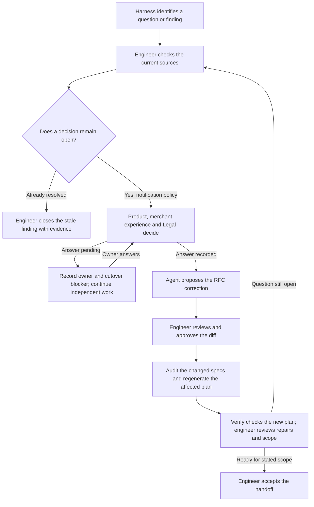

# 301-1E recovery: one payment, one unresolved decision

Recovery starts with an engineer checking a finding against the current sources.
If the answer needs a business or design decision, a human owner supplies that answer.
The agent then drafts the correction, the engineer reviews it, and the relevant checks
run again. This example concerns specification and plan recovery before implementation.

## The concrete example

A traveller buys a £2,499 television. In the proposed F2.1 flow, the risk assessment
holds the payment for review. An analyst later declines it, so the payment is voided.
**How does the shop learn the decision and explain it to the customer?**

The current sources establish:

- The [PRD's ST4 and borderline-payment flow](../../specs/product/adaptive-auth/1-high-value-traveller.md)
  require analyst review. ST3 asks for a plain-language decline explanation.
- [Checkout design v1.2, Held State](../../specs/design/adaptive-auth/1-checkout-challenge.md)
  already defines `held` and the message “We're checking this payment. The shop will
  confirm your order.” The old finding that this screen is missing is resolved in
  these documents.
- The [F2.1 RFC, API Surface](../../specs/tech/adaptive-auth/1-high-value-traveller.md)
  sends `holdExpired` on expiry, but sends no webhook for an analyst approval or decline.
- That RFC's **Unresolved Question 6** assigns the notification decision to Product,
  merchant experience and Legal. It blocks **review-queue cutover**, while independent
  build work can continue. The RFC currently describes the merchant learning the
  outcome through capture or the payment's voided status.

This is a documented open decision. It is not evidence that an implementation was run
or that a fresh Validator discovered the problem.

## Follow the recovery



| Step | Human action | Harness or SPEED action | Result to inspect |
|---|---|---|---|
| 1. Check the finding | Engineer reads the held state, webhook contract and Question 6. Closes the older missing-screen claim as resolved. | Cite the current passages and distinguish the resolved screen issue from the open notification decision. | A specific owner question: what communication follows an analyst decision? |
| 2. Decide the behavior | Product and merchant experience decide whether to add a decision notification, its trigger and recipient. Legal decides permitted reasons. Design/CX reviews customer-facing wording if it changes. | Present options and consequences; record the owner's answer and rationale. | A recorded decision, or an owner request with a cutover blocker. |
| 3. Draft the correction | Engineer translates the accepted decision into a technical contract. | Propose focused RFC edits covering the event, payload, delivery behavior and acceptance criteria, if the decision requires them. | A proposed diff linked to the owner decision. |
| 4. Accept the text | Engineer reads the actual diff, checks both RFCs' shared contracts and approves the wording. Upstream owners approve changes to their documents. | Apply approved edits and update decisions and coverage. | Reviewed spec changes; unresolved dependencies remain visible. |
| 5. Rebuild the plan | Engineer runs affected Audit and Plan, then checks the resulting task and dependencies. | Audit the edited sources and generate tasks from the revised contract. | A task for the decided notification behavior, where in scope, with an observable acceptance criterion. |
| 6. Check and hand off | Engineer reviews Verify's report, any task-file changes and the exact covered scope. Accept the stated scope only when its blockers are resolved. | Verify coverage; mechanically repair task records when appropriate and recheck. | A reviewed plan or an explicit blocked handoff. |

## What an answer would change

For illustration, consider this **unapproved teaching proposal**:

> Notify the merchant after an analyst declines a held payment, using an allowlisted
> reason identifier. The merchant owns presenting the agreed message to the customer.

If the owners accept that proposal, engineering would specify the decision event and
payload, recipient, duplicate handling, delivery failures and tests. One acceptance
criterion would check that an analyst decline voids the payment and produces the
agreed merchant notification. The actual timing, permitted reasons and delivery
guarantees still need decisions; this brief supplies no approved values.

If the owners retain the current polling/capture-based behavior, record that decision
and make the design and acceptance criteria explicit. Recovery does not require adding
a webhook. It requires settling the question and keeping specs and tasks consistent.

Until the owners answer, Question 6 remains open. Continue independent authoring and
build preparation; keep the review-queue cutover blocked. The engineer does not approve
Product or Legal policy on their behalf.

## What the engineer says to the harness

```text
Use the current checkout design and F2.1 RFC. The held screen already exists; close
that old missing-screen finding with source evidence. Investigate Unresolved Question 6:
after an analyst declines a held payment, how does the merchant learn the decision?
Show the current behavior and owner options. Record Product, merchant-experience and
Legal decisions as pending until answered. Propose RFC diffs only from recorded decisions;
wait for my review of the wording. Keep independent work moving and cutover blockers visible.
```

## Two other recovery routes

- **The spec is clear; only the task is wrong.** Review and correct the task, then
  Verify again. There is no new Product decision to obtain. The checked `speed verify`
  can edit mechanical task errors automatically; the engineer reviews its actual diff
  afterward. It is not an enforced approval-before-every-task-edit workflow.
- **The command or provider failed.** Preserve its output, investigate the command or
  response failure and rerun that command once addressed. A transport or parsing failure
  does not justify changing payment policy.

The checked CLI still plans and verifies a primary RFC. Record any uncovered F2.2 scope;
this worked F2.1 recovery does not establish a whole-feature plan or implementation pass.
