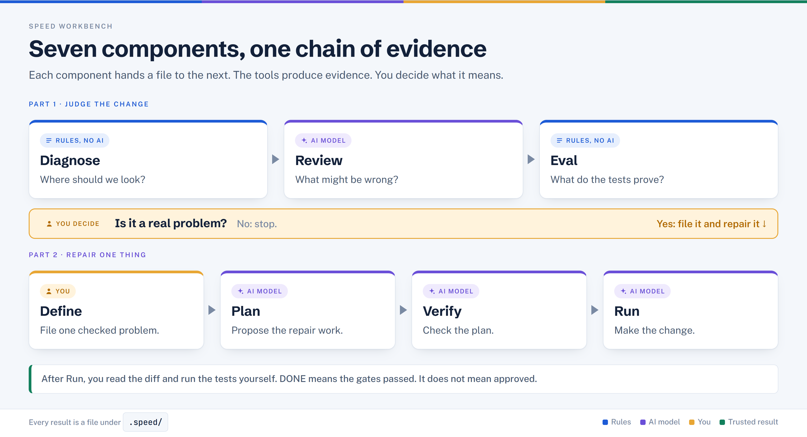

# SPEED Workbench components

One page per component used in Lab 3. Each page shows where the component sits in the pipeline, how it works inside, what it reads and writes, and what it leaves for you to decide.

## The pipeline

At every box the tool produces evidence and you make the decision. Nothing here approves a change on your behalf.

## Components

| Component | Page | What it does | AI involved? |
|---|---|---|---|
| `speed diagnose` | [diagnose.md](./diagnose.md) | Counts risk signals in the diff using the project's own rules | No |
| `speed review` | [review.md](./review.md) | An independent AI reviewer proposes claims to check | Yes |
| `speed eval` | [eval.md](./eval.md) | Selects and runs the tests that belong to the task, and records what passed | No |
| Define (dashboard) | [define.md](./define.md) | Turns a finding into a filed defect | No (the findings it shows came from Diagnose and Review) |
| `speed plan` | [plan.md](./plan.md) | Converts a defect into bounded repair tasks | Yes |
| `speed verify` | [verify.md](./verify.md) | A second check on whether the plan covers the defect | Yes |
| `speed run` | [run.md](./run.md) | An agent makes the repair in an isolated worktree, then gates run | Yes |

## What each stage hands to the next

| From | Leaves behind | Read by |
|---|---|---|
| diagnose | `.speed/features/<feature>/risk-surface.yaml` | you, then review and eval |
| review | review findings with location and reasoning | define |
| eval | summary and test plan under `eval/task-<n>/` | you |
| define | a defect file under `specs/defects/` | plan |
| plan | `tasks/<n>.json` and a contract | verify, run |
| verify | verification log and validation report | run |
| run | a repair branch `speed/<feature>/task-<n>-...` | you |

## Five ideas that cut across every component

| Idea | Meaning |
|---|---|
| Signal ≠ verdict | A rule matching a line is a question |
| Claim ≠ fact | A reviewer's statement still has to be checked |
| Pass ≠ safe | Only the chosen tests ran |
| Plan ≠ progress | The code has not changed yet |
| DONE ≠ approved | Gates passed; a person still reviews the revision |

## Reading tips

- Each page uses the same sections, so you can jump straight to **How it works** or **When it goes wrong**.
- Times are typical, not guaranteed. Where a fact was not verified against the source, the page says so.
- Commands are shown as used in Lab 3 (feature `payments`, then `payments-fee-repair`).

See also the [Lab Action Guide](../../LAB-ACTION-GUIDE.md) for the step-by-step hands-on path.
