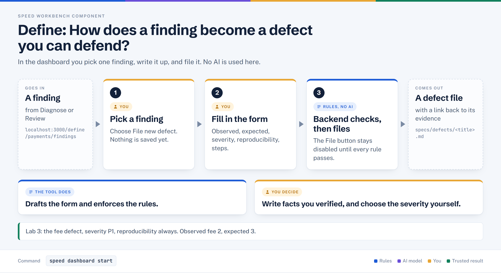

# Define: findings to defects

> Turns review and diagnose findings into a human-confirmed, traceable defect report, filed from the dashboard or read from the CLI.

## In plain words



1. You pick one finding on the dashboard and choose **File new defect**. Nothing is saved yet.
2. You replace the drafted wording with facts you verified, and choose severity and reproducibility.
3. The backend re-checks the rules. Only then is `specs/defects/<title>.md` written.

## Where it sits

```text
diagnose → review → eval → [DEFINE] → plan → verify → run
                            ^^^^^^
                         you are here
```

## At a glance

| | |
|---|---|
| Input | Diagnose and review evidence for a feature, plus the facts you check and type in |
| Output | `specs/defects/<slug>.md` and `.speed/defects/<slug>/state.json` (status `filed`) |
| Deterministic or AI | Deterministic. Drafting, validation and filing call no model; the findings were produced by Diagnose (rules) and Review (AI) |
| Typical time | Dashboard start about 20 seconds; filing time not verified |
| Used in Lab 3 | `speed dashboard start`, then `http://localhost:3000/define/payments/findings` (API on 4440), then `speed dashboard stop` |

Commands in this component:

| Command | What it does |
|---|---|
| `speed dashboard start` / `stop` / `status` / `ingest` | Runs the API (port 4440, `/graphql`) and the web page (port 3000) |
| `speed define feature <name> [--json] [--no-open]` | Read-only findings inbox in the terminal |
| `speed define defects [--feature --severity --status --source --lifecycle --search --format]` | Read-only defect portfolio |
| `speed defect <path-to-defect-spec>` | Takes a filed defect onward: triage, fix, integrate. Not used in Lab 3 |

## How it works, step by step

1. Collects findings from Diagnose (`risk-surface.yaml`), structured review logs, clean reviews, and archived evidence.
2. Each finding starts `Unresolved`. You pick an action; only "File new defect" opens a draft.
3. The draft is a preview. It carries over observed, expected, reproduction and context text from the evidence. Nothing is written.
4. You edit the title, severity, reproducibility and the other required fields.
5. On File, the backend re-checks that evidence and decisions have not changed since the draft was opened, and re-runs the validation.
6. It writes the report and state, records the decision, and the finding turns `Filed`.

Form validation rules (enforced in the page and again in the backend):

| Field | Rule |
|---|---|
| Title | 1 to 160 characters, one line; the filename comes from it |
| Severity | `P0`, `P1`, `P2` or `P3`, and the confirm checkbox ticked |
| Related features | 1 to 20 names of known features (pre-filled) |
| Reproducibility | Exactly `always`, `once`, or `intermittent (N/10)` with N 1 to 10 (case-insensitive) |
| Reproduction | First line starts `1.` or `1)` |
| Observed, Expected, Environment, Error output, Additional context | Not empty |
| Last known working | Not empty, one line |
| Filing rationale | Not empty |
| Possible duplicate | A similar title needs a duplicate reason; an identical filename is refused |
| Size and secrets | Each field 16 KiB or less; report 128 KiB or less; credential-like text is rejected |

## What it reads and writes

| Path (under the project root) | Role |
|---|---|
| `.speed/features/<feature>/risk-surface.yaml` | Reads: Diagnose findings |
| `.speed/features/<feature>/reviews/task-<id>.review` | Reads: clean review findings |
| `.speed/features/<feature>/evidence/<producer>/<task>/*.json` | Reads: archived evidence (the provenance link) |
| `.speed/features/<feature>/findings.json` | Reads and writes: your decisions on each finding |
| `specs/defects/<slug>.md` | Writes: the defect report, with a Provenance section |
| `.speed/defects/<slug>/state.json` | Writes: `status: filed`, `reported_severity`, `severity: null` |
| `.speed/defects/.intake/<request-id>/` | Writes: recovery receipt for the filing |

## Who decides what

| The tool does | You decide |
|---|---|
| Lists findings and their source evidence | Whether a finding is real |
| Pre-fills a draft from the evidence | The title, severity and every fact in the report |
| Recommends an action (you can choose another) | File, send back to a task, defer, or dismiss |
| Blocks an invalid or duplicate filing | Whether a similar defect is really a duplicate |
| Records who filed it and links the evidence | The repair scope and who owns the decision |
| Stores your severity as `reported_severity` | Triage sets the confirmed `severity` later |

## In Lab 3

- `speed dashboard start` ended with "Dashboard API running at http://127.0.0.1:4440/graphql" and "Frontend running at http://localhost:3000".
- The inbox for `payments` showed 12 findings, all Unresolved, including the 4 Clean review findings.
- Chosen finding: "The capture fee is computed with Math.floor..." (Clean review, Task 1). The page recommended sending it back; the lab filed it instead.
- The drawer "Create defect from finding" showed `NO WRITE`. Entered: severity P1 (confirmed), reproducibility `always`, reproduction beginning `1.`.
- Filed: `specs/defects/capture-fee-truncates-instead-of-rounding-half-up.md`, with `Source: define` and finding ID `finding-33bfe66b1af6b36f`.
- Observed: fee 2, merchant 198 for a capture of 200. Expected: fee 3, merchant 197 (and 149 / 9850 for 9999).
- `state.json` read `status: "filed"`, `reported_severity: "P1"`, `severity: null`. No code changed.
- `speed plan --feature payments-fee-repair --defects <that file>` then produced one task for `src/payments/service.ts`.

## When it goes wrong

| Symptom | Cause | What to do |
|---|---|---|
| File button stays disabled, only "Complete required fields to file" | A rule above is not met | Check Reproducibility (exact word), Reproduction starts `1.`, the empty fields, then the severity checkbox |
| "Possible duplicate" alert | A defect with a similar title exists | Open the existing report; if truly different, give a duplicate reason |
| Error "A defect already uses this title" | Same title, same filename | Open the existing defect; never file a duplicate |
| "Finding evidence changed; refresh and try again" (`STALE_EVIDENCE`) | Evidence or the task branch changed after the draft opened | Click Refresh evidence, re-check, file again |
| "Finding decisions changed" (`STALE_DECISION`) | Another decision was recorded meanwhile | Refresh the page and retry |
| Page shows "Disconnected" at first | API still starting | Wait; it turns "Connected" |
| `speed dashboard status` crashes: `COLOR_DONE: unbound variable` | `COLOR_DONE` is not defined in the Workbench libs | Harmless; use `start` and `stop` |
| "Missing Python dependencies" on start | fastapi, strawberry, uvicorn or watchdog not installed | Install the pip line the command prints |

## Related

[diagnose](./diagnose.md) · [review](./review.md) · [eval](./eval.md) · [define](./define.md) · [plan](./plan.md) · [verify](./verify.md) · [run](./run.md)
