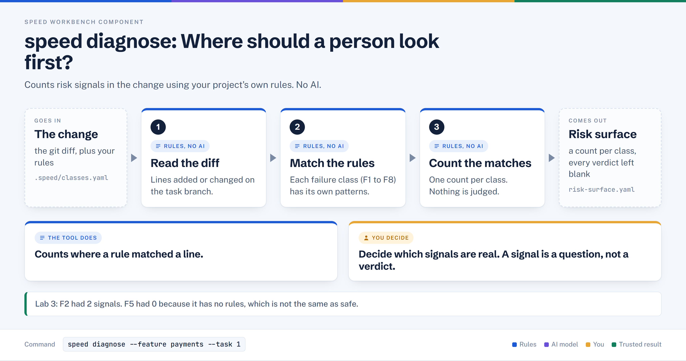

# speed diagnose

> Counts mechanical risk signals in an agent's change, using your project's own rules, and leaves every verdict for a human.

## In plain words



1. Reads the code change on the task branch.
2. Checks it against your project's rules, one failure class at a time (F1 to F8).
3. Prints a count per class and writes `risk-surface.yaml` with every verdict left blank.

## Where it sits

```text
 [ diagnose ] -> review -> eval -> define -> plan -> verify -> run
   ^^^^^^^^
   you are here
```

## At a glance

| | |
|---|---|
| Input | The task's git diff (`main...<branch>`), the project's `.speed/classes.yaml`, and three task fields: `branch`, `files_touched`, `agent_model` |
| Output | A per-class signal count on screen, an evidence JSON, and `risk-surface.yaml` with every verdict `undecided` |
| Deterministic or AI | Deterministic. Pattern matching only, no AI model is called |
| Typical time | About 5 seconds (Lab 3 facilitator script) |
| Command used in Lab 3 | `speed diagnose --feature payments --task 1` |

## How it works, step by step

1. Loads the project's class rules. There is no built-in fallback: if the file is missing, the command stops.
2. Reads only `branch`, `files_touched` and `agent_model`. It never reads the description, acceptance criteria or review feedback.
3. Diffs the task branch against the main branch (`main`, or `MAIN_BRANCH` if set).
4. Runs `lib/diagnose_engine.py`, which supports five rule kinds: `added-lines`, `changed-files-outside-declared`, `changed-source-without-test-change`, `changed-source-with-test-change`, `new-names-absent-from-spec`.
5. Prints a count per class. A class with no countable signal prints 0.
6. Archives an evidence record, then writes `risk-surface.yaml`. `plausible`, `costOfMissing` and `findableByReading` are always `undecided`.

## What it reads and writes

| Direction | Path | Notes |
|---|---|---|
| Reads | `speed.toml` `[diagnose]` | `classes_file`, `spec_file` |
| Reads | `.speed/classes.yaml` | Failure classes F1 to F8 and their rules |
| Reads | `.speed/features/<feature>/tasks/<id>.json` | Three fields only |
| Reads | `specs/product/payments.md` | Only for the `new-names-absent-from-spec` rule |
| Reads | git branch diff | `main...<branch>` |
| Writes | `.speed/features/<feature>/evidence/diagnose/<id>/<uuid>.json` | Permanent record of the run |
| Writes | `.speed/features/<feature>/risk-surface.yaml` | The file you edit next |

## Who decides what

**The tool does**
- Run your regex and structural rules over the diff.
- Count signals per class and record file, line and snippet as evidence.
- Exit 0 on any successful run, however many signals fired.

**You decide**
- Whether each class is `plausible`, what it `costOfMissing`, and whether it is `findableByReading`.
- Whether a signal is real or noise (for example a published test card number).
- Which downstream check each signal should route to.

## In Lab 3

Command: `speed diagnose --feature payments --task 1` (range `main...round-0`, exit 0).

| Class | Title | Signals |
|---|---|---|
| F1 | Hallucinated API, config key or dependency | 1 |
| F2 | Cardholder data leakage | 2 |
| F3 | Weak test that passes and proves nothing | 1 |
| F4 | Broken invariant under generated sequences or retry | 1 |
| F5 | Sycophantic self-approval | 0 |
| F6 | Wrong problem, scope creep, over-engineering | 1 |
| F7 | Silent regression in untouched behaviour | 1 |
| F8 | Specification gap | 1 |

What mattered:
- **F2:** the first rule matched an added `log.error(...)` call at `service.ts` line 67. The second matched the 16-digit published test cards `5105105105105100` and `4111111111111111`. Neither proves a leak; tracing `serialiseFailure` later showed the data is redacted.
- **F5 = 0 is silence, not a pass.** F5 has `rules: []`, so nothing can be counted for it.
- **F6** listed 13 files outside the declared list, mostly course setup files that arrive with the three-dot diff.

Output ends with: `Every verdict is undecided. Fill them in before running any check.`

## When it goes wrong

| Symptom | Cause | What to do |
|---|---|---|
| "No Diagnose class rules configured for this project." (exit 3) | `classes_file` file does not exist | Add `[diagnose] classes_file` to `speed.toml` and create the file |
| "Required: --task ID" (exit 3) | `--task` not passed | Pass `--task <id>` |
| "Task N has no branch recorded" or "Branch ... not found" (exit 3) | Task record lacks a branch, or the branch is gone | Fix the task record or recreate the branch |
| "Could not diff main...branch" (exit 3) | No local `main` | Create a local `main`, or set `MAIN_BRANCH` (Lab 3 script: Diagnose fails without one) |
| "diagnose engine failed: ..." (exit 3) | `classes.yaml` does not parse, or an unknown `look` type | Fix the YAML or the `look` name |
| Repair-loop counts identical to Stage 2 | Diagnose always diffs `main...<branch>`; it does not use `execution_base_commit` the way `review` does | Known limitation in the 2026-10-09 rehearsal; do not treat it as a result for the repair |
| Zero signals for a class | No rule fired, or the class has no rules | Not a ruling that the failure is absent |

## Related

[diagnose](./diagnose.md) | [review](./review.md) | [eval](./eval.md) | [define](./define.md) | [plan](./plan.md) | [verify](./verify.md) | [run](./run.md)
