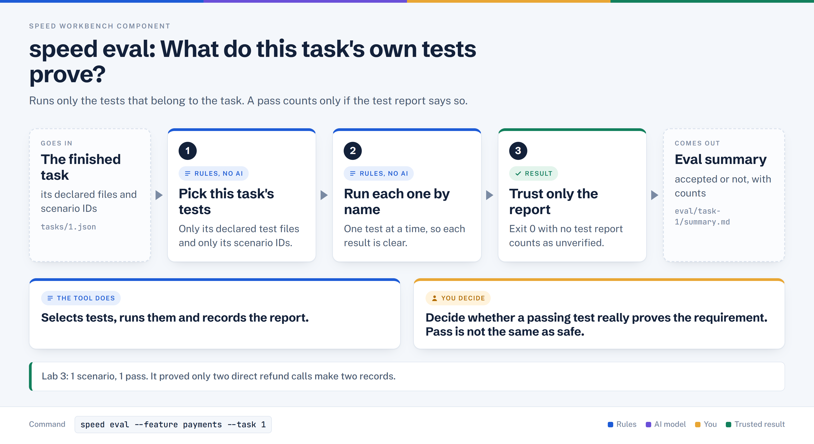

# speed eval

> Runs the tests that belong to a task, reads their JUnit reports, and records what that evidence does and does not prove.

## In plain words



1. Takes the tests that belong to this task: its declared files and its scenario IDs, nothing else.
2. Runs each selected test by its exact name.
3. Counts a pass only if the test report says it passed, then writes `summary.md`.

## Where it sits

```text
diagnose → review → [EVAL] → define → plan → verify → run
                      ^^^^
                   you are here
```

## At a glance

| | |
|---|---|
| Input | A feature with `done` tasks, a test spec (`specs/tests/<feature>.md`), `speed.toml` `[eval]`, optionally the saved review |
| Output | `eval/task-<id>/summary.md`, `report.json`, and `evaluation-task-<id>.yaml`; an immutable run folder |
| Deterministic or AI | Deterministic. No model is called by `speed eval`; the review it may read was AI-written |
| Typical time | A few seconds in Lab 3 (one test) |
| Used in Lab 3 | `speed eval --feature payments --task 1` (exit 0, accepted); `speed eval --feature payments-fee-repair --task 1 --test-spec specs/tests/payments.md` (exit 3, task not done) |

## How it works, step by step

1. Validates the task and feature IDs, confirms every state path stays inside the project, and takes the SPEED lock.
2. Picks the test spec: `--test-spec`, then the feature's `test_spec_path` file, then a path derived from the product spec, then `specs/tests/<feature>.md`.
3. Loads `tasks/*.json`. If any selected task is not `done`, it stops with "Evaluation requires done tasks".
4. Uses the first plan source that applies, strongest first (the order in the box). The review is used only for a task-scoped run.
5. Keeps scenarios the task owns (Filter 1) and only test files from `files_touched` that match `test_file_patterns` (Filter 2), then reads test titles without running them.
6. Creates a fresh run folder and records a SHA-256 fingerprint of the source tree, so a dirty tree is still tied to exact content.
7. Runs the configured command once per test with an exact `^name$` filter. A zero exit with no JUnit evidence is reported as unverifiable, not pass.
8. Scenario statuses are `pass`, `fail`, `partial`, `unverifiable`, `blocked_upstream`, or `not_applicable`; only all-pass is accepted.
9. Copies the report to the task's `eval/` folder and writes the YAML hand-off. A feature-level run also updates the feature `state.json`.

## What it reads and writes

| Path (under the project root) | Role |
|---|---|
| `speed.toml` `[eval]` (`test_command`, `test_file_patterns`) | Reads: the command and which files count as tests |
| `specs/tests/<feature>.md` | Reads: scenario catalogue (IDs and expected results) |
| `.speed/features/<feature>/tasks/<id>.json` | Reads: status, `files_touched`, acceptance criteria |
| `.speed/features/<feature>/reviews/task-<id>.review` | Reads (optional): findings that name a scenario |
| `test/*.test.ts` | Reads titles, then runs the selected tests |
| `.speed/features/<feature>/eval/task-<id>/runs/<run-id>/` | Writes: `test-plan.json`, `context.json`, `commands/<id>/result.json` |
| `.speed/features/<feature>/eval/task-<id>/summary.md`, `report.json` | Writes: the latest human and machine report |
| `.speed/features/<feature>/evaluation-task-<id>.yaml` | Writes: hand-off for later steps |

## Who decides what

| The tool does | You decide |
|---|---|
| Refuses to run unless the task is `done` | Whether the task should be marked done |
| Picks tests by scenario ID and file pattern | Which scenarios a task's criteria declare |
| Requires per-test JUnit evidence | Whether the passing test actually proves the requirement |
| Declines to borrow another task's test, and says so in `review_notes` | Whether to run a feature-scoped eval or run the test yourself |
| States "accepted" only for the declared scenarios, criteria and gates | Whether the change is good enough to ship |

## In Lab 3

Command: `speed eval --feature payments --task 1` (exit 0, a few seconds).

```text
Eval: payments (task 1)
Change: round-0 @ uncommitted-working-tree   spec: specs/tests/payments.md
1 scenarios, 1 pass · 1 of 1 criteria discharged
| RETRY-01 | Scenario: PASS | File: test/refund-retry.test.ts
✓ Accepted for the declared scenarios, criteria, and recorded gates.
```

- Plan source was the saved review: of 4 declared files, only `test/refund-retry.test.ts` matched `test/*.test.ts`.
- The command added `--test-name-pattern=^\[RETRY\-01\]\ a\ retried\ refund\ is\ accepted$`.
- `review_notes` said RISK-01 has no tagged test in the task's files, and RISK-02 exists but is owned by task 2.
- So the pass proves only that two direct `refund` calls produce two records. It says nothing about the retry helper or the fee.
- RISK-02 was then run by hand: `actual 2, expected 3`.
- `Change: ... uncommitted-working-tree` appears because `workbench init` left local files; the build fingerprint still pins the content.
- Repair feature: `speed eval --feature payments-fee-repair --task 1 ...` exited 3, "Evaluation requires done tasks", because `speed run` had marked the task failed.

## When it goes wrong

| Symptom | Cause | What to do |
|---|---|---|
| Exit 3, "Evaluation requires done tasks" | A selected task is not `done` | Check `jq .status .speed/features/<f>/tasks/<id>.json`; fix the run, do not hand-edit status |
| Exit 3, "No test spec found" | No `--test-spec` and no `specs/tests/<feature>.md` | Pass `--test-spec PATH` |
| Exit 3, "outside the project or crosses a symlink" | Spec or plan path fails the path guard | Use a real file inside the project |
| Exit 2, "Not accepted" | Eval ran; a result failed or was never examined | Read the `failed` and `not examined` lists in the output |
| Result is `unverifiable` | Test exited 0 but wrote no JUnit report, or the test was not discovered | Check `test_command` writes to `$SPEED_EVAL_JUNIT_FILE` |
| Manual RISK-02 run selects zero tests | Brackets in the name pattern not escaped | Copy the command exactly, quoted |
| `uncommitted-working-tree` in the Change line | Working tree is dirty | Expected in the lab; do not call the run clean |

## Related

[diagnose](./diagnose.md) · [review](./review.md) · [eval](./eval.md) · [define](./define.md) · [plan](./plan.md) · [verify](./verify.md) · [run](./run.md)
