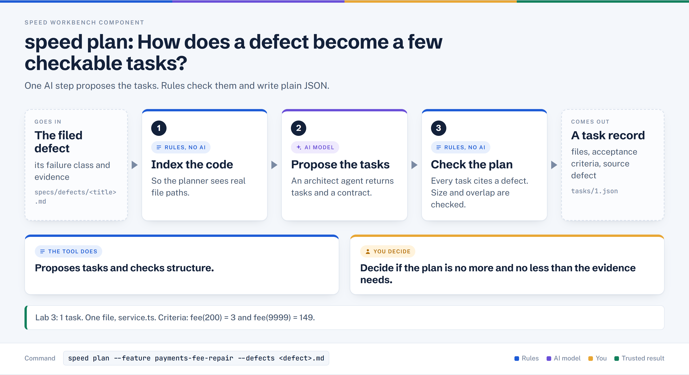

# speed plan

> Turns a defect report (or a spec) into a small, reviewable set of task records, each with the files it may touch and the criteria it will be judged by.

## In plain words



1. Builds a map of the code so the planner works from real file paths.
2. An AI architect proposes the repair tasks and a contract.
3. Rule gates check every task cites a defect and the tasks are sensible in size, then write `tasks/1.json`.

## Where it sits

```text
diagnose -> review -> eval -> define -> [ PLAN ] -> verify -> run
                                          ^^^^
```

## At a glance

| Item | Value |
|---|---|
| Input | Defect file(s) via `--defects`, or a tech spec (product and design specs are picked up by path convention); plus an indexed codebase |
| Output | `contract.json`, one `tasks/<id>.json` per task, `logs/validation-report.json` (when the Architect reports notes) |
| Deterministic or AI | Mixed. One AI step (the Architect agent); everything around it is deterministic (indexing, gates, file writes) |
| Typical time | About 1 minute in Lab 3 (Architect about 30 s) |
| Command used in Lab 3 | `speed plan --feature payments-fee-repair --defects specs/defects/capture-fee-truncates-instead-of-rounding-half-up.md` |

## How it works, step by step

Defect-driven mode (the Lab 3 path), in the order the code runs it:

1. Reads each defect file; `Failure Class:` and `Evidence:` lines are extracted with grep and carried onto the task unchanged.
2. Builds the codebase index so the Architect works from real file paths, not guesses.
3. Sends defect text, its exact path, and code context to the Architect; it returns `tasks`, `contract`, `validation`.
4. Prints the validation report; only `critical` blocks, `warning` and `note` are shown and saved.
5. Every task must cite a supplied defect and every defect must have a task; an F8 defect may only produce an "Escalate:" task, and that gate has no bypass.
6. Writes the contract and one JSON file per task, with `base_commit`, `files_touched`, `spec_references`, `source_defect`.
7. Checks task size, overlapping `files_touched` between parallel tasks, and bridge-symbol dependencies; missing bridge edges are auto-patched into `depends_on`.

Notes (verified in code): in `--defects` mode the spec audit and the Product Guardian check are skipped. In spec mode they run, and a phased two-pass Architect plus the coverage verifier (`agents/coverage-verifier.md`) apply only when the audit estimates more than 10 tasks (or `FORCE_COVERAGE=true`). `agents/architect-skeleton.md` and `architect-enrich.md` are not referenced by `plan.sh`; plan uses `agents/architect.md`.

## What it reads and writes

| Path | Direction | What |
|---|---|---|
| `specs/defects/<name>.md` (project root) | reads | Defect report passed to `--defects` |
| `specs/tech/<name>.md` (+ `product/`, `design/`, `tests/`) | reads | Spec mode only |
| `.speed/context/` | reads/writes | Layer 1 index (project map, semantic graph) |
| `.speed/features/<feature>/contract.json` | writes | Entities and core queries the plan creates |
| `.speed/features/<feature>/tasks/<id>.json` | writes | One task record each (replaces earlier tasks) |
| `.speed/features/<feature>/logs/validation-report.json` | writes | Architect notes (only when it reported any) |
| `.speed/features/<feature>/plan-inputs.json` | writes | Defect paths with hashes (defect mode) |
| `.speed/features/<feature>/cache/` | writes | Cached Architect result keyed by spec hash; `--force` bypasses |
| `.speed/features/<feature>/logs/architect-raw-*.log` | writes | Raw Architect output for diagnosis |

## Who decides what

| The tool does | You decide |
|---|---|
| Indexes the repo and gives the Architect the exact defect path | Which defect is worth fixing and how tightly it is scoped |
| Blocks plans that lose the defect trail or break the F8 rule | Whether the proposed task is the right size, in the right file |
| Corrects a unique mis-pathed file (for example `src/service.ts` to `src/payments/service.ts`) | Whether the acceptance criteria are strong enough to trust |
| Saves everything as plain JSON you can open | Whether to proceed to `speed verify` |

## In Lab 3

Command: `speed plan --feature payments-fee-repair --defects specs/defects/capture-fee-truncates-instead-of-rounding-half-up.md`

| Field in `tasks/1.json` | Value |
|---|---|
| Title | Replace truncating Math.floor with applyRate in capture fee calculation |
| `files_touched` | `src/payments/service.ts` only |
| `depends_on` | none (one task) |
| `source_defect` | the filed defect path |
| Acceptance criteria | fee for 200 equals 3 (RISK-02 test command); fee for 9999 equals 149; capture line calls `applyRate`; authorisation, refund and retry paths unchanged |
| Validation report | one `note`: no product or tech spec given, defect detail was sufficient |

Rehearsal result: exit 0, 1 task, traceability and decomposition gates passed. The Architect left `spec_references` empty, and the tool attached the sole defect itself (log line "Attached sole defect source to 1 unreferenced task(s)").

`contract.json` declares one function entity, `capture` in `src/payments/service.ts`, with the core question "Does the capture fee use half-up rounding via applyRate instead of truncating via Math.floor?".

## When it goes wrong

| Symptom | Cause | What to do |
|---|---|---|
| "--feature is required in defect-driven mode" | `--defects` used without `--feature` | Add `--feature <name>` |
| "Defect path is a directory" / "Defect file not found" | `--defects` takes explicit files only | List each defect file path |
| "Architect found CRITICAL validation issues" | Architect reports a blocking problem | Read `logs/validation-report.json`, fix the input, re-run |
| "Defect traceability gate FAILED" | A task cites no supplied defect, or a defect has no task | Read `logs/defect-traceability-gate.json`; re-plan (with several defects the tool cannot guess the link) |
| "F8 gate FAILED" | An F8 (specification gap) defect produced an implementation task | Human decision needed; no override exists |
| "Decomposition quality gate FAILED" | Oversized task, overlapping files, or another structural issue | Read `logs/decomposition-gate.json`; fix and re-plan (`SKIP_DECOMP=true` exists, use with care) |
| Same result after editing a spec | Architect output is cached by spec hash | Re-run with `--force` |
| Output ends "Next: speed run --feature ..." | Hint printed by `plan` | If you have confirmed the plan, `speed run` is next and skips verify. The Lab 3 rehearsal report flags this hint as contradicting "never skip verify"; run `speed verify` first |

## Related

[diagnose](./diagnose.md) | [review](./review.md) | [eval](./eval.md) | [define](./define.md) | [plan](./plan.md) | [verify](./verify.md) | [run](./run.md)
