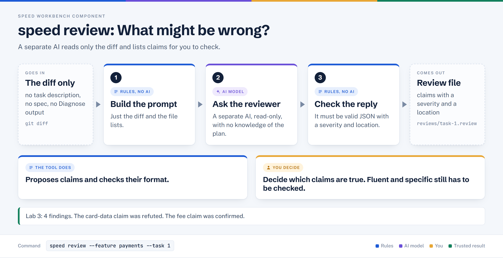

# speed review

> Has a separate AI reviewer read only the diff and report specific, checkable claims, without the task or spec to steer it.

## In plain words



1. Gives a separate AI reviewer only the diff. It never sees the spec or the task description.
2. The reviewer returns claims: what might be wrong, where, and how severe.
3. Rules check the reply is well formed, then it is saved as `reviews/task-1.review`.

## Where it sits

```text
 diagnose -> [ review ] -> eval -> define -> plan -> verify -> run
              ^^^^^^^^
              you are here
```

## At a glance

| | |
|---|---|
| Input | `git diff <base>..<branch>`, the recorded author model, and the declared file lists |
| Output | A JSON list of findings on screen, an evidence record, and `reviews/task-<id>.review` |
| Deterministic or AI | AI. One reviewer agent call (support model, `sonnet` by default), then deterministic schema validation |
| Typical time | 3 to 5 minutes (Lab 3 facilitator script) |
| Command used in Lab 3 | `speed review --feature payments --task 1` |

## How it works, step by step

1. Reads `branch`, the author model and the declared file lists. It stops if the branch or author model is missing.
2. Uses the task's `execution_base_commit` when recorded; otherwise recovers a merge-base (see `_review_base_for_task` in `lib/cmd/review.sh`).
3. The prompt holds only the author model, the file lists and the diff. Task description, acceptance criteria, product spec, review fields and Diagnose output are deliberately left out.
4. Runs `agents/clean-context-reviewer.md` with read-only tools. It may Read, Glob and Grep to resolve facts about code the diff references.
5. `lib/review_evidence.py` checks the reply: one JSON object, `schema_version` 1, severity one of `critical`, `major`, `minor`, `nit`, no extra fields.
6. Archives the evidence and writes `reviews/task-<id>.review`; the last printed line is the diff range.

## What it reads and writes

| Direction | Path | Notes |
|---|---|---|
| Reads | `.speed/features/<feature>/tasks/<id>.json` | Branch, author model, file lists |
| Reads | git diff `<base>..<branch>` | The only change content the reviewer sees |
| Reads | `agents/clean-context-reviewer.md` | Reviewer instructions and output contract |
| Writes | `.speed/features/<feature>/evidence/clean_review/<id>/<uuid>.json` | Evidence record |
| Writes | `.speed/features/<feature>/reviews/task-<id>.review` | Read later by Eval and Define |

## Who decides what

**The tool does**
- Build a bounded input and call one reviewer with read-only tools.
- Reject malformed replies instead of saving them.
- Copy a `scenario_id` only when it literally appears in the diff, and mark `testable` when a test could settle the claim.

**You decide**
- Whether each claim is true. Severity is the reviewer's opinion, not a priority.
- Which claims to check, reproduce, file as defects, or dismiss.
- The real priority, set later in Define.

## In Lab 3

Command: `speed review --feature payments --task 1`. Exit 0, range `d08a680..round-0` (the merge-base, the same change Diagnose scanned). Four findings in the rehearsal:

| Severity | Where | Claim | scenario_id |
|---|---|---|---|
| critical | `service.ts:67` | Raw request with full PAN passed to `log.error` | RISK-01 |
| major | `service.ts:119` | `Math.floor` truncates the fee; RISK-02 expects half-up | RISK-02 |
| major | `refund-retry.test.ts:9` | Test never calls `reissueRefund`; retry loop unverified | RETRY-01 |
| nit | `cards.ts` | `RETRY_TEST_CARD` exported but never used | none |

What mattered: the critical PAN claim did not survive checking, because `serialiseFailure` calls `redact()` first. The fee claim was confirmed and became the defect. Wording, count and severity can vary between runs.

In the repair loop, `speed review --feature payments-fee-repair --task 1` used range `de5cd73..<branch>` (implementation only) and returned 1 major finding: half-up rounding can round against the merchant, a policy question for a human.

## When it goes wrong

| Symptom | Cause | What to do |
|---|---|---|
| "Task N not found" / "has no branch" (exit 3) | Missing task file or branch field | Check `.speed/features/<feature>/tasks/<id>.json` |
| "has no recorded author model" (exit 3) | Neither `author_model` nor `agent_model` in the task | Record the model on the task |
| "Branch ... not found" / "Base branch ... not found" (exit 3) | Branch or main missing locally | Create or fetch the branch |
| "Reviewer agent failed" or "returned empty output" (exit 3) | Agent CLI or authentication problem | Run `speed review` once before class to prove auth end to end (Lab 3 script) |
| "Could not preserve review evidence; prior review was not replaced" (exit 3) | Reply failed schema validation, or evidence could not be written | Re-run; the earlier review is kept |
| Findings differ from the facilitator's | The reviewer is an AI; wording, count and severity vary | Check claims, not counts |
| Spec-only issues are missed | The reviewer is not given the spec | Expected by design; Eval and Define cover them |

## Related

[diagnose](./diagnose.md) | [review](./review.md) | [eval](./eval.md) | [define](./define.md) | [plan](./plan.md) | [verify](./verify.md) | [run](./run.md)
