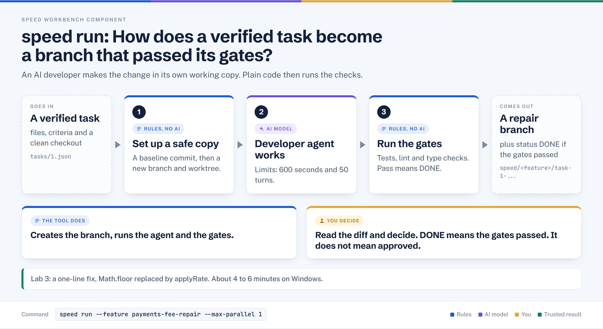
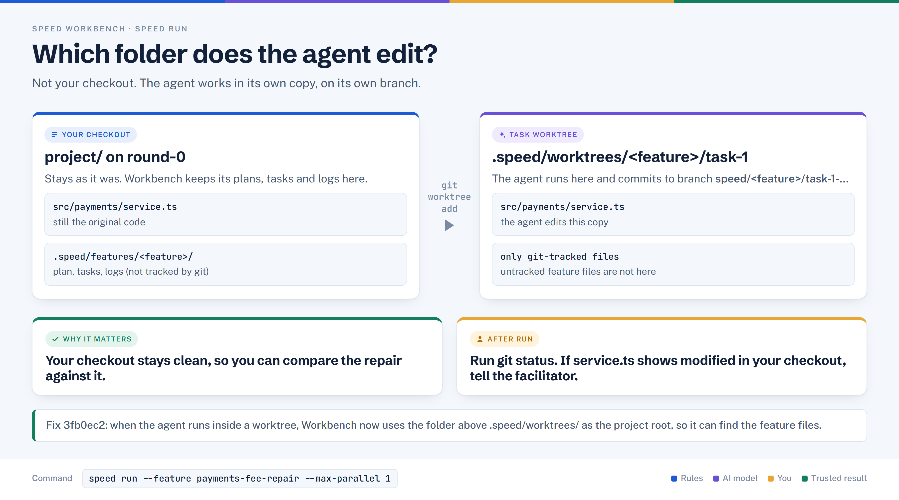

# speed run

> Hands each approved task to a developer agent in its own git worktree and branch, then marks the task DONE only if the configured quality gates pass.

## In plain words



1. Makes a baseline commit, then creates a new branch and a separate working copy (a worktree) for the task.
2. An AI developer agent edits that copy. It has 600 seconds and 50 turns.
3. Plain code runs the gates. If they pass the task is marked DONE. DONE is not approval.

## Where it sits

```text
diagnose → review → eval → define → plan → verify → [RUN]
                                                     ^^^
                                                you are here
```

## At a glance

| | |
|---|---|
| Input | Pending tasks in `.speed/features/<feature>/tasks/*.json` (written by `plan`, checked by `verify`) |
| Output | A branch per task (`speed/<feature>/task-N-<slug>`), updated task JSON, per-task log, run summary |
| Deterministic or AI | Both. Orchestration and gates are deterministic shell; the code change is written by an AI developer agent |
| Typical time | 4–6 min observed on Windows (one task) |
| Command used in Lab 3 | `speed run --feature payments-fee-repair --max-parallel 1` |

## How it works, step by step

1. **Preconditions.** Resolves the feature, takes a per-feature lock, requires the `timeout` command, and refuses a circular `depends_on` graph. If a previous run left state `running`, it kills orphan agents, resets those tasks to pending and breaks the stale lock.
2. **Baseline commit.** If the checkout is dirty, `speed: baseline commit for operation` is created so task branches see untracked files. The commit hash is stored in each pending task as `execution_base_commit`.
3. **Branch audit.** Applies only when the task branch already exists from an earlier attempt. `pass` marks the task DONE without a new agent; `blocked` marks it blocked; `fail` or `empty` continues to the agent.
4. **Worktree and branch.** `git worktree add -b` creates the branch from the current HEAD and checks it out under `.speed/worktrees/<feature>/task-N`. `node_modules`, `.venv` and `.next` are symlinked in.
5. **Agent launch.** `claude -p` starts in the worktree with `agents/developer.md`, `--max-turns 50` (`SPEED_MAX_TURNS`) and a 600 s wall-clock limit (`SPEED_TIMEOUT`). One timeout on a non-opus model retries once on opus.
6. **Gates.** Workbench runs the same checks as `speed gates --full`: grounding (non-empty diff, declared files, scope), syntax, lint, typecheck, tests. Unconfigured gates are skipped, not passed.
7. **Status update.** Pass: task `done`, worktree removed. Fail: task `failed`, worktree kept, debugger agent started. A third failed retry becomes `blocked`.

## Worktrees at a glance



## What it reads and writes

| Path | Read / write | Purpose |
|---|---|---|
| `.speed/features/<feature>/tasks/N.json` | both | Task, status, `branch`, `gate_results`, `execution_base_commit`, `retry_count` |
| `.speed/features/<feature>/state.json` | both | `running` while active, `idle` at the end |
| `.speed/features/<feature>/logs/N.log` | write | Agent output; `debugger-N.json` is read on retry |
| `.speed/features/<feature>/speed.lock` | write | Exclusive lock (a directory), removed at exit |
| `.speed/worktrees/<feature>/task-N/` | write | Task worktree; removed on DONE |
| `speed/<feature>/task-N-<slug>` (git branch) | write | Candidate fix commits |
| `agents/developer.md`, `AGENTS.md` / `CLAUDE.md` | read | Agent instructions and project context |
| `speed.toml` | read | Gate commands, timeout, turns, model |

## Who decides what

| The tool does | You decide |
|---|---|
| Creates the baseline commit, branch and worktree | Whether the checkout is clean enough to run |
| Runs the agent with a 600 s / 50-turn budget | Whether a failed task needs guidance, a bigger model or a split |
| Runs configured gates and records pass/fail | Whether the gates are strong enough (lint and typecheck may be "not configured") |
| Marks the task `done` | Whether the diff is in scope and correct, and whether to merge |

**DONE is not approved.** DONE means the configured gates passed. Nobody has reviewed the diff, and nothing is merged. Read the diff next (`speed diagnose`, `speed review`, `speed eval` on the new change).

**How it relates to `speed gates` and `speed retry`**

| Command | Relationship to run |
|---|---|
| `speed gates -f <feature> --task N [--fast\|--full]` | The same gate code that run calls in step 6. The agent runs it inside the worktree as it works; you can run it by hand. `--full` promotes a `failed` task to `done` |
| `speed retry --task-id N --context "…"` | Resets a `failed` or `blocked` task to pending after you give guidance (a blind retry is refused). Runs a branch audit first: if the branch already passes gates, the task becomes DONE. Then run `speed run` again |

## In Lab 3

- Branch pattern: `speed/payments-fee-repair/task-1-replace-truncating-math-floor-with-apply`.
- Expected log: baseline commit, worktree created, agent spawned, scope/syntax/tests passed, `Task 1: DONE`.
- Rehearsal on 9 Oct (Windows): attempt 1 exited 128 (no git identity). Attempt 2 exited 5: the agent committed a correct one-line `applyRate` fix, but the task was marked `failed`.
- Why: the agent runs `speed gates -f payments-fee-repair` in the worktree. Workbench took that folder as the project root, and the worktree has only git-tracked files. The new feature is gitignored, so it failed with `Feature '…' not found`. The agent fell back to another feature and used up its 50 turns.
- Fix in commit `3fb0ec2` (`lib/config.sh`, +6 lines): if the working directory contains `/.speed/worktrees/`, the project root becomes the part before it.

```text
 before: PROJECT_ROOT = project/.speed/worktrees/F/task-1  → .speed/features/F missing
 after : PROJECT_ROOT = project                            → .speed/features/F found
```

- Timing: 4–6 min on Windows (observed); about 1 min on macOS. I did not find a recorded run after `3fb0ec2` in the report.

## When it goes wrong

| Symptom | Cause | What to do |
|---|---|---|
| Exit 128 right after "Creating baseline commit…", no message | `git commit` fails without `user.name` / `user.email`; its output is discarded | `git config user.name "…"` and `git config user.email "…"` (repo-local is enough), run again |
| `Reached max turns (50)`, then `Agent CLI error (exit code 1)`, task `failed`, exit 5 | Agent used its turn budget; a commit may still exist on the branch | Check `git log` on the task branch, run `speed gates -f F --task N --full`, or `speed retry --task-id N --context "…"` |
| `Feature '…' not found` inside the worktree | Commit before `3fb0ec2`: worktree root treated as project | Update Workbench to `3fb0ec2` or later |
| Main checkout shows modified `src/payments/service.ts` | Rehearsal: the agent's first edit hit the main-checkout path before the worktree copy (not changed by `3fb0ec2`) | Run `git status` in main; compare with the branch diff. Do not run again until it is clean or committed on purpose, because the next baseline commit includes it |
| `'<cmd>' is already running` or stale lock | An earlier run was killed; `speed.lock` remains | A dead PID is broken automatically. If it persists: `speed recover`. `speed run` also recovers when `state.json` says `running` |
| Task `timed out after 600s` | Agent exceeded the limit | First timeout retries once on opus automatically; after that `speed retry --task-id N --escalate --context "…"` |
| `Blind retries are not allowed` | `speed retry` without `--context` | Read the error shown, then give guidance in `--context` |

## Related

[diagnose](./diagnose.md) · [review](./review.md) · [eval](./eval.md) · [define](./define.md) · [plan](./plan.md) · [verify](./verify.md) · [run](./run.md)
