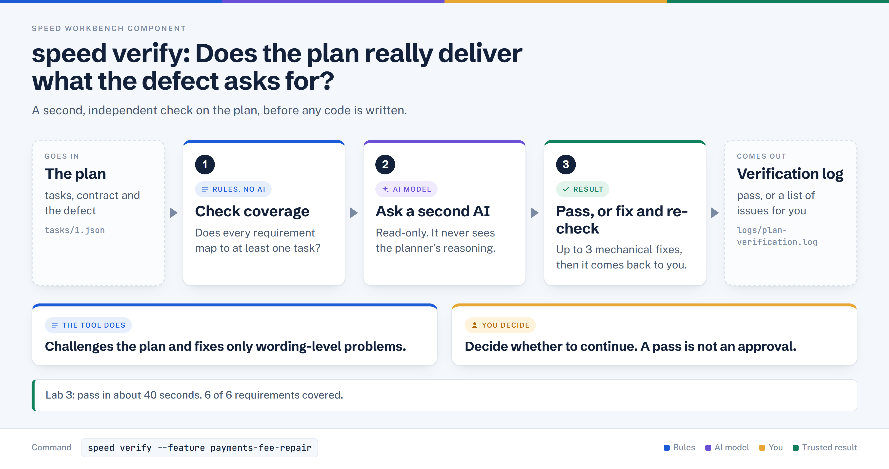

# speed verify

> Has an independent agent check, without seeing the planner's reasoning, that the task plan really delivers what the defect or spec requires.

## In plain words



1. A code check confirms each requirement in the spec is covered by at least one task.
2. A second AI, which cannot see how the plan was made, checks it independently.
3. On a pass it prints the next step. On a fail it tries up to 3 mechanical fixes, then hands back to you.

## Where it sits

```text
diagnose -> review -> eval -> define -> plan -> [ VERIFY ] -> run
                                                  ^^^^^^
```

## At a glance

| Item | Value |
|---|---|
| Input | The planned `tasks/*.json`, `contract.json`, and the authorizing spec (or the filed defect) |
| Output | A printed report, `logs/plan-verification.log`, and a pass/fail exit status |
| Deterministic or AI | Mixed. A deterministic spec-to-task coverage check, then the Plan Verifier agent (AI, read-only); a Fix Agent runs only on failure |
| Typical time | About 40 s for the Verifier in Lab 3; `docs/running-speed.md` quotes 2-8 min in general |
| Command used in Lab 3 | `speed verify --feature payments-fee-repair` |

## How it works, step by step

1. Reads every task, the contract, and the authority; with no spec path it rebuilds context from each task's `spec_references` (the filed defect).
2. Runs the coverage check in code and appends any uncovered requirements to the Verifier's context.
3. Sends spec, tasks, contract (and code index context) to the Plan Verifier, told to read the spec first, form its own view, then check the plan. It does not receive the Architect's reasoning.
4. The reply's `status` decides: `pass` ends with the next-step hint; anything other than `pass` or `fail` prints a warning to review manually.
5. On `fail`, a mechanical Fix Agent may edit task JSON; judgment calls go to `needs_human`. It stops early if the same failures repeat.

## What it reads and writes

| Path | Direction | What |
|---|---|---|
| `.speed/features/<feature>/tasks/*.json` | reads (Fix Agent may edit) | The plan under test |
| `.speed/features/<feature>/contract.json` | reads | Entities and core queries |
| `.speed/features/<feature>/cross_cutting_concerns.json` | reads | If the Architect produced any |
| `specs/defects/<name>.md` or the spec | reads | Authority for the plan |
| `.speed/features/<feature>/logs/plan-verification.log` | writes | Raw Verifier output (overwritten on re-verify) |

## Who decides what

| The tool does | You decide |
|---|---|
| Maps each requirement to a task and reports covered / missing / partial / drifted | Whether the plan matches your intent when the Verifier is uncertain |
| Applies mechanical task-JSON fixes (up to 3 cycles) | Anything needing a spec interpretation or trade-off |
| Stops with exit 1 and a clear list when it cannot proceed | When to edit the task or the spec and re-run |
| Never edits source code (the Verifier is read-only) | Whether to continue to `speed run` |

## In Lab 3

Command: `speed verify --feature payments-fee-repair`. The authority was the filed defect (log line "Reading filed defect authorization for defect-driven plan").

| Requirement checked | Result |
|---|---|
| Capture uses the existing `applyRate(requested, SCHEME_FEE_RATE)` helper | covered by task 1 |
| Capture of 200 gives fee 3, merchant 197 | covered |
| Capture of 9999 gives fee 149, merchant 9850 | covered |
| Change only the capture fee calculation in `src/payments/service.ts` | covered |
| Retry, refund, authorisation and unrelated fee paths unchanged | covered |
| RISK-02 test passes | covered |

Result: status `pass`, core question answerable, 6 of 6 requirements covered, 0 critical failures, 0 drift. The Verifier read `service.ts` and `money.ts` to confirm `applyRate` exists and rounds half-up. Report: `logs/plan-verification.log`.

## When it goes wrong

| Symptom | Cause | What to do |
|---|---|---|
| "No tasks found. Run 'speed plan <spec>' first." | No plan for this feature | Run `speed plan` first, with the same `--feature` |
| "No feature context. Use --feature <name>" | Feature not given | Add `--feature <name>` |
| "Product spec or defect authorization not found" | No spec path saved and no readable defect in `spec_references` | Re-run `speed plan` (spec file or `--defects`) |
| "Plan verification FAILED" with listed issues | Verifier found critical failures | Read the "Spec says / Plan says" lines, fix the task or spec, re-run `speed verify` |
| "All issues require human judgment" or "Same critical failures persist" | Auto-fix cannot decide, or fixes did not help | Decide yourself, edit, re-run (exit 1) |
| "Plan Verifier returned unparseable output" | Reply was not valid JSON | Open `logs/plan-verification.log` |
| "Could not parse verification status" | Status was neither pass nor fail | Review the report manually |
| Output ends "Next: speed run" | Printed on PASS | If you have confirmed the result, go to `speed run`. `plan` also prints this hint before verify has run, so it is not a pass signal |

## Related

[diagnose](./diagnose.md) | [review](./review.md) | [eval](./eval.md) | [define](./define.md) | [plan](./plan.md) | [verify](./verify.md) | [run](./run.md)
