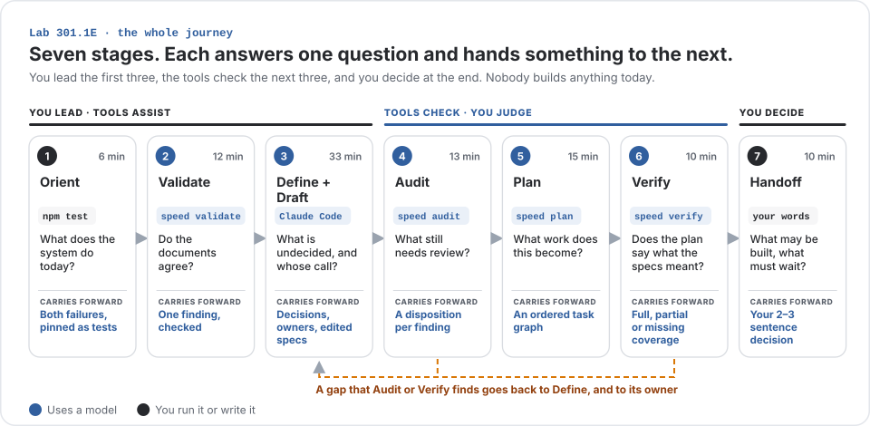
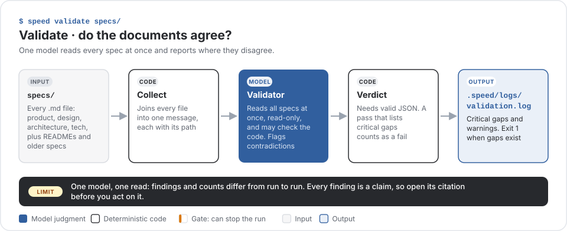
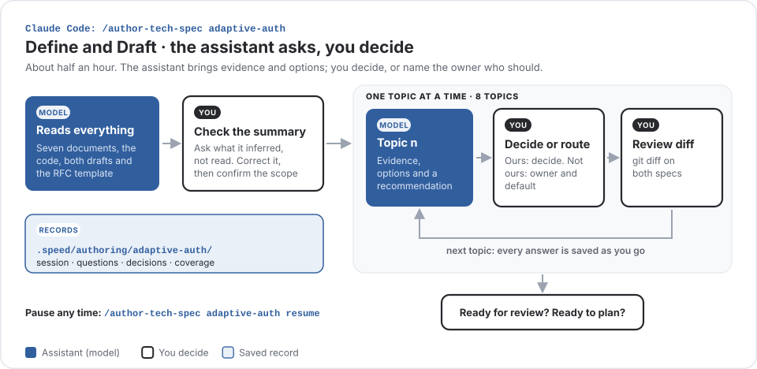
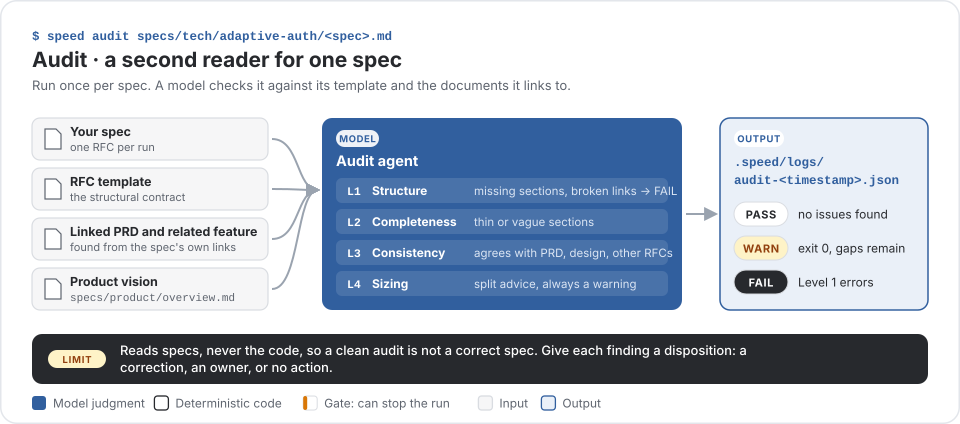
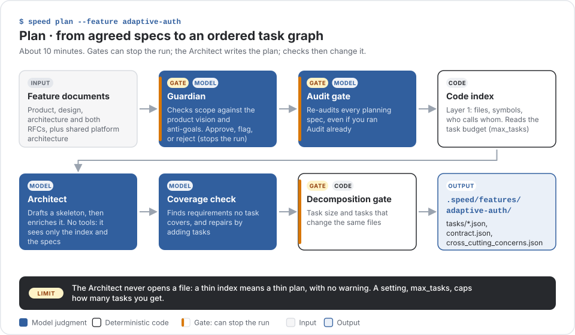
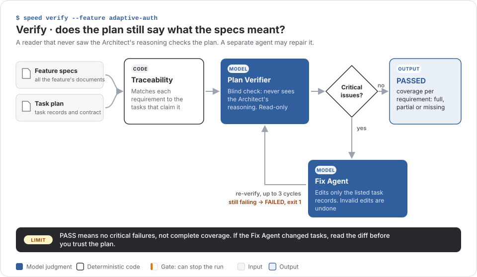

# Lab 301.1E: Define, Audit, Plan

Today you take one payments feature from documents other teams wrote to a checked plan. The case: a genuine traveler gets declined for a large purchase abroad, and a script tests forty stolen cards across twenty merchants without being stopped. Both fixes share one bank challenge. You will review two technical specs, decide what is yours to decide, plan the work and hand it off. Nobody builds anything today.

## How to use this guide

Every step has the same three parts:

- **What's happening** explains the stage. Read it while your facilitator talks.
- **Run** lists what to type, in order. Each item says whether it goes in the terminal or in Claude Code. Click "Example output" under a command to see what a rehearsal run printed.
- **Look for** is a checklist. Tick each item before you move on.

Your output will not match the examples word for word. Findings, counts and timings vary from person to person, and that is expected.



## Before you start

Setup is already done. Keep your IDE on the left, Claude Code on the right, and a separate terminal for the `speed` commands.

If you open a new terminal at any point, run the export lines from the setup message again, then:

```bash
cd "$HOME/Lab/301.1E/payments-validation-fixture"
```

If you get stuck, ask a coach and tell them the step number and the error.

---

## 1. Orient (6 min)

### What's happening

Before reading any document, you look at what the system does today. The existing tests pass, but they record behavior the business wants to change: the traveler is declined and the attack is approved. Don't edit anything in this step.

### Run

1. In the terminal, run the test suite:

   ```bash
   node --version
   npm test
   baseline_exit=$?
   printf 'Baseline test exit code: %s\n' "$baseline_exit"
   ```

   <details><summary>Example output</summary>

   ```text
   ℹ tests 102
   ℹ pass 101
   ℹ fail 1
   Baseline test exit code: 1
   ```

   </details>

2. In your IDE, open these files in this order:

   | File | What to find |
   |---|---|
   | `test/gateway.test.ts`, test GW-02 | The test expects the traveler to be declined |
   | `test/gateway.test.ts`, test GW-05 | The test expects the attack to be approved in full |
   | `test/fixtures/traffic.ts`, `cardTestingBurst` | Forty cards, twenty merchants, each card used once |
   | `src/risk/rules.ts`, `evaluate` | The two rules behind both decisions |

### Look for

- [ ] 102 tests ran. If `[WB-10]` failed (101 of 102), that is a known fixture check. Note it and carry on.
- [ ] You can say why the traveler is declined and why the attack is approved.
- [ ] Amounts are in minor units: `249_900` means £2,499.

---

## 2. Validate (12 min)

### What's happening

Seven documents from different teams describe the new feature. Validate sends all of them to a model at once and asks where they disagree. What comes back is a list of findings. A finding is a claim, not a fact, so you check one against its sources before you act on it.



### Run

1. In the terminal, set up a folder for this session's evidence. Repeat this line in any new terminal.

   ```bash
   course_evidence_dir=".speed/course-301-1e/session"
   mkdir -p "$course_evidence_dir"
   ```

2. Run Validate. It takes about 3 minutes and ends with exit code 1, which is expected.

   ```bash
   speed validate specs/
   validate_exit=$?
   printf 'Validate exit code: %s\n' "$validate_exit"
   cp -R .speed/logs "$course_evidence_dir/after-validate-logs"
   ```

   <details><summary>Example output</summary>

   ```text
   →     Found 17 spec files
   →     Sending to Validator agent...
     ✓ Validator  2m43s
   ✓     Validation report saved to .speed/logs/validation.log
   Validation Summary
     ✗ specs/product/payments.md (ST1)
     ✗ specs/tech/adaptive-auth/1-high-value-traveller.md (State Machine, Review item) …
     ✗ specs/tech/adaptive-auth/2-card-testing.md (Merchant notification payload; …)
     ⚠ 19 warning(s)
   ✗ err   Validation FAILED — fix critical gaps before running 'speed plan'
   ✗ err   4 critical gap(s) found
   Validate exit code: 1
   ```

   A warning about optional grammars at the start is harmless.

   </details>

3. In your IDE, open `.speed/logs/validation.log` and find the entry about **held payments expiring after 72 hours**. It may be listed under warnings. If it isn't there, use this claim instead:

   ```text
   The draft describes expiry after 72 hours and a holdExpired webhook.
   Check whether it identifies what executes expiry and lists the
   implementation in File Impact.
   ```

4. In the terminal, start Claude Code at the fixture root. Don't start the authoring skill yet.

   ```bash
   claude
   ```

5. In Claude Code, paste this prompt, then the finding or the claim:

   ```text
   Check this finding against the source documents.
   Confirm or refute it with citations. Keep it brief; make no edits.
   [paste the finding here]
   ```

### Look for

- [ ] Every point in the answer cites a file and line you can open.
- [ ] You reached one verdict: **confirmed** (the documents really disagree), **partly confirmed** (keep only what the citations support) or **refuted** (set it aside and note why).
- [ ] You wrote down what the draft promises and what it leaves unclear.
- [ ] You skipped findings about older files such as `specs/product/payments.md`. They are outside today's feature.

---

## 3. Define and Draft (33 min)

### What's happening

This is the main stage. An authoring assistant reads all the documents, the code and the two draft specs, then works through eight open topics with you, one at a time. For each topic it brings evidence and options. You decide the parts that are engineering's call and name an owner for everything else. Nothing changes in the specs until you approve an edit.



The eight topics, in order. Not everyone reaches topic eight, and that's fine.

| # | Topic | A good answer |
|---|---|---|
| 1 | Trusting the bank's answer | Checkout may only cancel; a bank result comes only from our side. Leave how we get it open until the provider confirms, with a default and an owner |
| 2 | Calls to the bank, and speed | Don't redesign the flow. Where the architecture contradicts itself, send it to Architecture with your preferred option |
| 3 | Time limits | A number without a source stays provisional, with an owner. Don't add timeouts the documents don't ask for |
| 4 | What the two specs share | Both specs say the same thing about every shared piece, and name which one owns it |
| 5 | Decisions that aren't ours | Decide none. Name the owner, what it holds up, and an interim suggestion |
| 6 | How long to trial it quietly | Check both numbers mean the same thing. Align with the architecture or record an exception. Don't pick a number |
| 7 | Out-of-date references | Fix only references that point nowhere. Don't rename a configuration label |
| 8 | Who else a block affects | Don't set limits. Record the effect on genuine customers and send the limits to Risk |

Every answer has the same shape: decide the part that's ours and the sources support, leave open what depends on someone else with a default and a named owner, move anything that belongs to a later topic, then ask to see the proposed change.

### Run

1. If Claude Code is still open from Validate, type `/exit`. Then start it again in a terminal where you ran the setup exports:

   ```bash
   claude
   ```

2. In Claude Code, start the authoring skill. If it fails in the shell, you typed it in the wrong window.

   ```text
   /author-tech-spec adaptive-auth
   ```

   After a minute or two it stops with a summary of what it understood and asks whether that's right.

3. In Claude Code, before you confirm, ask the question everyone asks:

   ```text
   Before I confirm: what in this summary is inferred rather than stated
   in the sources, and which of those would change the design if they
   turned out to be wrong? Cite the lines.
   ```

4. In Claude Code, reply in your own words. Add anything your question turned up, correct anything that's off, and confirm the scope is both specs and what they share. A plain "confirmed" is fine if nothing turned up.

5. Topic 1 together. Your facilitator runs it on screen. Answer it in your own words, using the table above.

6. When the assistant proposes an edit, check what actually changed in the terminal before you accept it. Save any open editor file first.

   ```bash
   git diff --stat -- specs/tech/adaptive-auth/
   git diff -- specs/tech/adaptive-auth/1-high-value-traveller.md specs/tech/adaptive-auth/2-card-testing.md
   ```

7. On your own, about 10 minutes. Pick one or two topics closest to your own work. For the rest, accept the recommended option and let the assistant record it as provisional.

8. When the facilitator calls time, ask the assistant to save the next action, your decisions and the owner requests. To continue later in a new conversation, use `/author-tech-spec adaptive-auth resume`.

9. Before you leave this stage, ask the assistant in your own words: is this ready for review, and is it ready to plan?

### Look for

- [ ] The summary matches what you saw in Orient, and your Validate finding is in its list.
- [ ] Each answer is written down in one line: `decided: … | open: … → owner`
- [ ] Every accepted edit appears in both specs where they share something.
- [ ] You accepted only changes that match the decision you made.
- [ ] Nothing in another team's document was changed. Their gaps went to their owner.
- [ ] The records exist in `.speed/authoring/adaptive-auth/`: `session.md`, `questions.md`, `decisions.md` and `coverage.md`.

---

## 4. Audit (13 min)

### What's happening

You wrote the changes, so you are not the best judge of them. Audit is a second reader. It checks each spec against its template and the documents it links to, at four levels: structure, completeness, consistency and size. It reads specs, not code, so a clean audit does not mean the spec is correct.



### Run

1. In the terminal, audit the traveler spec. It takes about a minute.

   ```bash
   speed audit specs/tech/adaptive-auth/1-high-value-traveller.md
   audit_f21_exit=$?
   printf 'F2.1 Audit exit code: %s\n' "$audit_f21_exit"
   cp -R .speed/logs "$course_evidence_dir/after-audit-f21-logs"
   ```

   <details><summary>Example output</summary>

   ```text
   →     Spec type: rfc
   →     Template:  ~/Lab/workbench/templates/rfc.md
   →     Vision:    specs/product/overview.md
     ✓ Audit  55s
     ⚠ [L3] Testing > Acceptance Criteria — PRD success criterion 'Every declined payment carries a reason …'
     ⚠ [L4] Key Decisions — estimated at about 18 implementation tasks, above the 15-task split threshold
     ⚠ Sizing: Consider splitting into multiple child RFCs (~18 tasks)
   →     Report saved to .speed/logs/audit-1793674684.json
   ⚠ warn  Audit: WARN (3 warning(s))
   F2.1 Audit exit code: 0
   ```

   `[L1]` is structure, `[L2]` completeness, `[L3]` consistency with other documents and `[L4]` sizing.

   </details>

2. Then audit the card-testing spec:

   ```bash
   speed audit specs/tech/adaptive-auth/2-card-testing.md
   audit_f22_exit=$?
   printf 'F2.2 Audit exit code: %s\n' "$audit_f22_exit"
   cp -R .speed/logs "$course_evidence_dir/after-audit-f22-logs"
   ```

3. In your IDE, compare the **Produces** section of the traveler spec with the **Consumes** section of the card-testing spec. Does the first provide the cancellation behavior the second expects? Check the source even if Audit didn't mention it.

### Look for

- [ ] You read the status and the findings together. `WARN` with exit 0 is common and still has gaps.
- [ ] You decided what to do with one finding: a correction, an owner, or no action.
- [ ] You wrote it in one line: `finding · evidence · owner · effect on Plan`
- [ ] You did not split a spec just because Audit suggested it. Sizing is advice.
- [ ] If an owner decision blocks the scope, you said so. Your facilitator will walk through the blocked route.

---

## 5. Plan (15 min)

### What's happening

Plan turns both specs into an ordered set of tasks. It works in three passes. Two gates first decide whether the work should be planned at all. Then the Architect drafts the tasks from an index of the code, without opening any files. Then checks look for missing requirements and tasks that are too large, and change the plan. Start only when your facilitator says the scope is cleared.



### Run

1. In the terminal, run Plan. It takes about 11 minutes. Let it finish and don't restart it.

   ```bash
   speed plan --feature adaptive-auth
   ```

   <details><summary>Example output</summary>

   ```text
   →     Running Product Guardian (pre-plan)...
   ⚠ warn  Guardian: FLAGGED — Adaptive authorisation fits the vision well. …
   →     Task budget: at most 8 task(s)
   →     Building Layer 1 context index...
   ✓     Layer 1: built
     ✓ Architect  1m47s
     ✓ Architect (enrich)  2m11s
   ⚠ warn  Coverage passed with 7 minor gap(s)
   ✓     Decomposition quality gate passed
   Task Graph
     ○  1    F1 amendment: capture block, idempotent void, void in caller's transaction
     ○  2    Risk decision core: reason codes, scorer contract, decision policy
     ○  4    Review queue, risk narrative, hold expiry and webhook outbox (depends on: 1, 2, 3)
     ○  8    Gateway F2.2: block check, attempt recording, … (depends on: 5, 6, 7)
   Tasks: 8 total | 0 done | 0 running | 8 pending | 0 failed
   Next: speed run --feature adaptive-auth to execute the approved plan
   ```

   </details>

   While it runs, think about which dependency matters most for the scope you chose.

2. Read the task graph at the end of the output, top to bottom. That's the build order. Two of the titles start with "Gateway".

3. In your IDE's file tree, open `.speed/features/adaptive-auth/tasks/` and open the two Gateway tasks. Search each one for `travellerTelevision`, the traveler from test GW-02. (The project-wide search skips `.speed` because it's gitignored, so open the files from the tree.)

4. One folder up, open `cross_cutting_concerns.json`. These are the rules every task must follow. Look for the one about the step-up outcome.

5. Scroll back up in the terminal to the list just before "Validation report saved". Each NOTE or WARNING is something Plan couldn't settle, with who should confirm it. Then go back to a Gateway task and scroll down to `assumptions`.

> [!IMPORTANT]
> The last line of the Plan output suggests `speed run`. Don't run it. Nothing is built today.

### Look for

- [ ] The Guardian approved or flagged the plan. A flag is a note and the run continues. A rejection stops it: keep the report and tell a coach.
- [ ] You noted how many tasks you got. A setting called `max_tasks` caps the number, so it may match your neighbor's for that reason alone.
- [ ] One dependency you picked runs in the order you would expect.
- [ ] No two tasks change `gateway.ts` at the same time without one waiting for the other.
- [ ] GW-02 now expects a step-up, not a decline, in one of the Gateway tasks.
- [ ] Your topic 1 decision appears as a cross-cutting rule. If it doesn't, note what's there instead.
- [ ] One default Plan chose that nobody in the room decided, and who has to confirm it.

---

## 6. Verify (10 min)

### What's happening

So far only the planner has looked at its own plan. Verify gives it to a separate reader that never saw the Architect's reasoning. If that reader finds critical problems, a third agent edits the task records and the plan is checked again, up to three times. A pass means no critical problems. It does not mean every requirement is fully covered.



### Run

1. In the terminal, snapshot the plan, verify it, then compare. It usually takes about 2 minutes, longer if it repairs the plan.

   ```bash
   cp -R .speed/features/adaptive-auth "$course_evidence_dir/before-verify-feature"
   speed verify --feature adaptive-auth
   verify_exit=$?
   printf 'Verify exit code: %s\n' "$verify_exit"
   cp -R .speed/features/adaptive-auth "$course_evidence_dir/after-verify-feature"
   diff -ru "$course_evidence_dir/before-verify-feature/tasks" .speed/features/adaptive-auth/tasks
   ```

   <details><summary>Example output</summary>

   ```text
   →     Reading feature specs (7 documents):
   →     Gathering task plan (8 tasks)...
   ✓     Spec traceability: all requirements covered
   →     Sending to Plan Verifier agent (blind check)...
       Spec requirements: 18 of 29 covered
       ✗ ST5: step-up that cannot complete is handled consistently with risk policy (status: partial)
       ✗ Every declined payment carries a reason the merchant can show the cardholder (status: partial)
       …
     Summary: 0 critical, 5 warnings, 9 recommendations
   ✓     Plan verification PASSED
   Verify exit code: 0
   ```

   </details>

2. In your IDE, open `.speed/features/adaptive-auth/logs/plan-verification.log`.

### Look for

- [ ] The two numbers disagree. The first check says every requirement is covered; the reader that checks meaning says something like 18 of 29. That difference is what this step is about.
- [ ] You followed one requirement and know whether its coverage is full, partial or missing.
- [ ] If the diff shows changes, you read them before trusting the plan. A diff exit code of 1 only means files changed.

---

## 7. Handoff (10 min)

### What's happening

The session ends with a decision you write, not with code. Imagine a colleague picks this up tomorrow. They need to know what can go ahead, what must wait, and who has to decide. A blocked handoff is a valid result.

### Run

1. On your own, about 5 minutes, write two or three sentences using your saved evidence, in this shape:

   ```text
   Can proceed: …
   Must wait: …
   Owner who unblocks it: …
   Evidence: …
   ```

### Look for

- [ ] You said what was verified and for which scope, not just "it passed".
- [ ] Decisions that belong to someone else are listed as decisions with an owner, not as tasks.
- [ ] You did not run `speed run`.

---

## Close (5 min)

One question to take back to your own work: which decision in your project has no named owner?

Then three questions for us: what should we cut, what should we keep exactly as it is, and where did you lose the thread?

---

## If you get stuck

| What you see | What to do |
|---|---|
| `speed` is missing, or runs the wrong Workbench, in a new terminal | Run the export lines from the setup message again and check `command -v speed` |
| `$course_evidence_dir` is empty in a new terminal | Run the first line of the evidence block in step 2 again |
| "Unparseable output" or a sign-in error | Run `claude auth status`. It must show the team plan. Keep the output and tell a coach |
| A skill command fails in the shell | Start `claude` first, then type it inside the conversation |
| The assistant stopped after reading its inputs | It is waiting for you. Answer its question; don't restart the skill |
| A warning about optional grammars | Harmless. Carry on |
| The Guardian rejects the plan | Stop. Keep the report and tell a coach. Don't add skip flags |
| Plan failed but task files exist | They are from an earlier run. Don't treat them as a new plan |
| Verify is repairing the plan | Wait for it to finish, then read the diff |
| Python is older than 3.12 | Tell a coach before you continue |

## Words we use

| Word | Meaning |
|---|---|
| Spec | A technical specification, also called an RFC. Today there are two |
| Finding | A tool's claim about the documents |
| Gap | A finding the sources confirm |
| Owner | The person whose function decides the question |
| Blocker | A gap that is waiting on its owner |
| Disposition | What you decide to do with a finding |
| Verified | Checked for a stated scope. Not the same as complete |

## Four habits to take with you

1. Read the sources against each other.
2. Send each gap to its owner.
3. Write a change someone else can test.
4. Know what each tool checks, and what it can't see.

And for every output, ask: what went in, what was checked, what came out, what is still unknown, and who owns the next decision?
